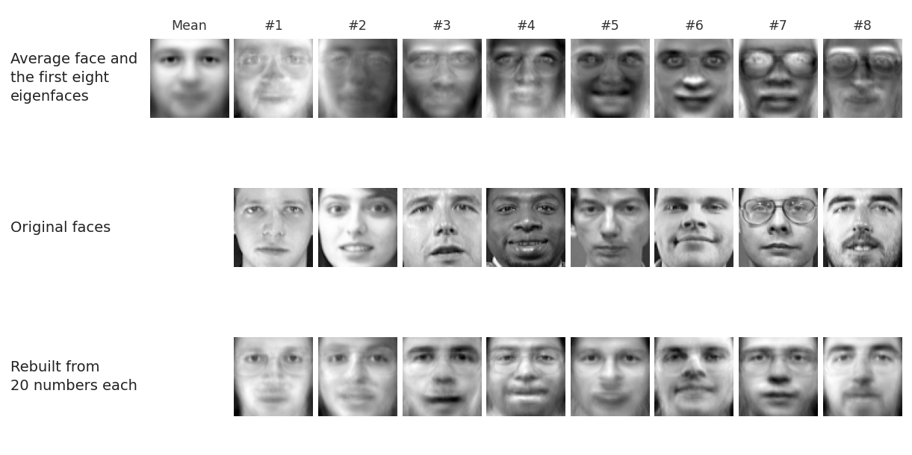

# Eigenfaces

Principal component analysis on 400 face photos: compress each 64×64 image to 20 numbers, rebuild it, and look at what those numbers capture.



## Results

Twenty components keep 76.3% of the variance in the faces. The largest reconstruction error (L2 norm) is 6.25 with 20 components and 2.14 with 150.

## Run it

```bash
pip install -r requirements.txt
jupyter notebook eigenfaces.ipynb
```

The photos are the Olivetti faces from AT&T Laboratories Cambridge, downloaded on first run through scikit-learn.
